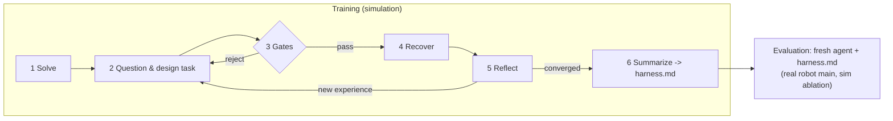

# GAH workflow

> **Phase 1 runs sections 2, 3, 7 and 8 only** (GAH training in sim). Sections 4–6 (RSI baseline, evaluation, metrics) are for phase 2.

## 1. Overview



- One agent plays both roles. It is the **solver**, writing the pipeline. It is also the **task designer**, writing variations that break that pipeline.
- Training happens only in simulation. Evaluation runs mainly on the real robot, with a small simulation subset for ablations.

## 2. Fixed settings (phase 1)

| Setting | Value |
|---|---|
| Agent | Claude Opus 5.5 in Claude Code |
| Training tasks (A) | LIBERO-Goal: `open_the_middle_drawer_of_the_cabinet`, `turn_on_the_stove`, `push_the_plate_to_the_front_of_the_stove`, `put_the_wine_bottle_on_the_rack`, `put_the_cream_cheese_in_the_bowl` |
| Training tasks (B) | RoboTwin 2.0: `lift_pot`, `handover_block`, `stack_blocks_two`, `click_bell`, `open_laptop` |
| Training tasks (C) | ManiSkill3: `PegInsertionSide-v1`, `PlugCharger-v1`, `PullCubeTool-v1`, `LiftPegUpright-v1`, `PlaceSphere-v1` (motion-planning solutions serve as the solvability oracle) |
| Sim held-out tasks | RoboTwin 2.0: `stack_bowls_two`, `handover_mic`, `open_microwave`, `press_stapler`, `place_object_basket` |
| Real tasks | 5 unseen tasks, dynamic + collision |
| Success estimate in sim | 10 seeds per scene |
| τ (recovered) | 0.8 |
| Break gate | original pipeline success on the variation ≤ s0 / 2 |
| Variance gate | at most 2 parameter-tuning variations in a row |
| Max repair iterations per variation | 6. If not recovered, mark the variation `unsolved`, revert it, and design another. |
| Convergence | 2 consecutive rounds with no novel general rule, or 5 accepted variations per task |
| Evaluation attempts | n = 4 (pass@1 and pass@4) |
| Real variations per task | 3 |

## 3. GAH training (one run per training task)

Prompt: `prompts/gah_train.md`.

1. **Solve.** The agent writes `benchmarks/<bench>/runs/<task>/pipeline.py` against `docs/api_spec.md`. It runs `benchmarks/<bench>/tools/eval.py` until success ≥ τ, then records `s0`.
2. **Question and design.** The agent lists the assumptions the pipeline makes. It writes one variation `benchmarks/<bench>/runs/<task>/variations/vK.yaml` that violates one of them.
3. **Gates.** `benchmarks/<bench>/tools/gate.py` runs a **frozen copy** of the pipeline from before this round on the variation.
   - **Break gate:** pass if success ≤ s0 / 2.
   - **Variance gate:** reject if this is the third parameter-tuning variation in a row. "Parameter tuning" means the variation only changes the magnitude of an aspect that the previous variation already changed, for example moving the same object further in the same direction. The agent labels this in the YAML, and the tool also checks it by diffing against the previous variation.
   - **Integrity:** reject if the success function or the gate tool changed (hash check).
4. **Recover.** The agent repairs the pipeline until success ≥ τ on the new variation **and** on all earlier accepted variations and the original task.
5. **Reflect.** The agent appends one entry to `benchmarks/<bench>/runs/<task>/reflections.jsonl` (schema in section 7).
6. **Converge.** Stop under the rule in section 2. After all training tasks finish, run `prompts/gah_summarize.md` over every `reflections.jsonl` to produce `harness/harness_GAH_vX.md`.

## 4. RSI baseline (one run per training task)

Prompt: `prompts/rsi_train.md`.

- Same tasks, same API and same tools, but **the agent cannot edit the scene**. It only sees the task's default randomization.
- The loop is: run, diagnose failures, fix, and reflect with the same schema.
- The token budget per task equals the GAH tokens used on that task. Read it from GAH's logs. If GAH is not finished yet, use a cap of 2M tokens per task and record it.
- Summarize with the same `prompts/gah_summarize.md` into `harness/harness_RSI.md`.

The only difference between GAH and RSI is whether the agent designs new tasks.

## 5. Evaluation (all arms)

Prompt: `prompts/deploy.md`, with `{HARNESS}` filled from the arm's harness file (empty for No prompt).

- **Fresh session:**
  - no memory or files from training except the harness;
  - no simulator during real-robot evaluation;
  - no human hints.
- **Attempts:**
  - The agent submits a program and the operator runs it.
  - The agent receives the outcome: success or fail, camera frames, and execution log.
  - Up to 4 attempts.
- **Real robot:** 5 tasks × 3 variations × 3 arms. Run attempt 1 for every arm and variation first, then the retries.
- **Order:** randomize the arm order per task, so that fatigue or lighting drift does not favor one arm.
- **Sim ablation:** same protocol on the 5 held-out RoboTwin tasks, 10 seeds per task.

## 6. Metrics

- **pass@1:** success on the first submitted program.
- **pass@4:** success within 4 attempts.
- **Cost:** tokens, wall-clock time, and attempts used.
- **Training statistics:**
  - variations designed and accepted per task;
  - rejection rate per gate;
  - rounds to convergence;
  - tokens.

## 7. Logging

### Runs

One JSON line per run in `benchmarks/<bench>/logs/runs.jsonl`:

```json
{"phase": "train|eval", "arm": "GAH|RSI|NoPrompt", "task": "lift_pot", "variation": "v3",
 "backend": "sim|real", "attempt": 1, "success": true, "success_rate": 0.9, "seeds": 10,
 "tokens_in": 0, "tokens_out": 0, "wall_clock_s": 0, "program": "runs/lift_pot/pipeline@<git-sha>",
 "notes": ""}
```

### Reflections

One JSON line per reflection in `benchmarks/<bench>/runs/<task>/reflections.jsonl`:

```json
{"round": 2, "task": "lift_pot", "variation": "v2", "axis": "object_position|orientation|color|size|lighting|distractor|obstacle|object_motion|camera|dynamics",
 "parameter_tuning": false, "s0": 0.9, "s_break": 0.2, "s_recovered": 0.9,
 "weakness": "...", "how_found": "...", "why_missed": "...", "fix": "...",
 "general_rule": "one sentence, no task or object names", "novel": true}
```

## 8. Variation file

`benchmarks/<bench>/runs/<task>/variations/vK.yaml`:

```yaml
id: v3
axis: obstacle
parameter_tuning: false
assumption_violated: "the straight-line path from pre-grasp to grasp is free"
edits:            # keys exposed by the scene-edit interface (docs/api_spec.md, Scene edits)
  add_obstacle: {shape: box, size: [0.05, 0.05, 0.15], pose: [0.42, 0.05, 0.75]}
```
